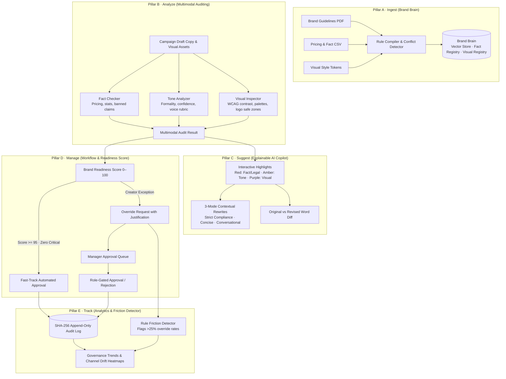

# VeriBrand AI: Autonomous Brand Governance & Multimodal Compliance Platform

Enterprise marketing teams produce thousands of creative assets across dozens of regional agencies and freelance creators. Without continuous automated guardrails, brands suffer from **brand drift**, **outdated pricing schedules**, **prohibited claims with regulatory liability**, **off-brand tone**, and **visual styling violations**.

**VeriBrand AI** automates brand governance across five foundational pillars—delivering deterministic verification, explainable AI rewrites, and role-enforced approval workflows.

> **Deterministic rules establish what is compliant. Explainable AI suggests context-aware rewrites. Humans retain authority over high-risk policy exceptions.**

---

## The Five Pillars of Brand Governance



---

## Core Capabilities

### 1. Pillar A · Ingest (Brand Brain & Conflict Detection)
- **Three Knowledge Stores**:
  - **Vector Store (RAG)**: Chunks brand philosophy, mission statements, and editorial voice guidelines.
  - **Fact Registry**: Structured database of canonical pricing, SLA commitments, certified statistics, legal disclaimers, and prohibited terms.
  - **Visual Asset Registry**: Approved primary/secondary hex palettes, maximum Delta-E tolerances, font weight allowances, and logo clear-space rules.
- **Cross-Document Conflict Engine**: Flags contradictory rules across uploaded guidelines (e.g., conflicting pricing or incompatible brand voice directives) before rules are compiled.

### 2. Pillar B · Analyze (Multimodal Parallel Auditing)
- **Fact Checker**: Deterministic string matching and fuzzy matching (via regex, RapidFuzz, SequenceMatcher) detects outdated prices (`$39`), deprecated product names (`Acme Cloud Legacy`), unsupported claims (`100% unhackable`), and missing mandatory disclaimers.
- **Tone Analyzer**: Measures copy against enterprise rubrics (formality, confidence, technicality, empathy) and flags prohibited tones (slang, hyperbolic claims, condescending phrasing).
- **Visual Inspector**: Computer vision inspections calculate WCAG 2.1 contrast ratios, check dominant asset colors against approved brand tokens with Delta-E tolerances, and verify logo safe-zone clearance.

### 3. Pillar C · Suggest (Explainable AI Copilot)
- **Grammarly & PR-Style Workspace**: Interactive color-coded inline text highlights:
  - **Red**: Critical factual inaccuracies and blacklisted legal claims.
  - **Amber**: Off-brand tone violations.
  - **Purple**: Visual styling issues.
- **Three Contextual Rewrite Modes**:
  - `Strict Compliance`: Enterprise-grade accuracy citing audited SOC 2 / legal standards.
  - `Concise`: High-impact, punchy copy tailored for character-limited ads.
  - `Conversational`: Warm, approachable phrasing while preserving brand guardrails.
- **Zero-Hallucination Citations**: Every finding displays its exact source document title, page number, and section name.
- **Word-Level Diff Engine**: Side-by-side revision comparisons showing exact additions and deletions between drafts.

### 4. Pillar D · Manage (Approval Workflow & Readiness Scoring)
- **Brand Readiness Score (0–100)**: Transparent weighted penalty deductions:
  - Factual / Legal violations: `-25.0 pts` each.
  - Visual violations: `-12.0 pts` each.
  - Tone violations: `-5.0 pts` each.
- **Fast-Track Qualified Approval**: Content drafts achieving a Readiness Score of `≥ 95.0` with zero critical blockers qualify for instant automated approval.
- **Creator Override Requests**: Creators submit formal exceptions with mandatory justification text (min 10 characters) and risk acknowledgment checkboxes.
- **Manager Review Queue**: Reviewers inspect creator justifications alongside violation context before granting approvals or escalating to Legal Specialists.

### 5. Pillar E · Track (Governance Analytics & Rule Friction Detector)
- **Rule Friction Detection**: Identifies brand rules with high manager-approved override rates (`> 25%`). Automatically synthesizes creator justifications into actionable recommendations for Brand Admins (e.g., proposing social-media short-form disclaimer variants).
- **Channel Drift Heatmaps**: Visualizes violation densities across Social Ads, Email Newsletters, Landing Pages, and Display Banners.
- **Rolling Compliance Trends**: Tracks 7, 30, and 90-day organizational compliance trajectories.
- **Cryptographic Audit Chain**: Every ingestion, scan, rewrite acceptance, override request, and approval is recorded in an append-only ledger cryptographically chained using SHA-256 hashes with real-time integrity verification.

---

## Role-Based Access Control (RBAC)

VeriBrand AI supports five distinct enterprise governance roles:

| Role | User Name | Description | Key Permissions |
| :--- | :--- | :--- | :--- |
| **Organization Owner** | Elena Vance | Full enterprise governance & organizational administration | All 16 capabilities |
| **Brand Admin** | Marcus Sterling | Manages guidelines, brand brain, rules, and conflict resolution | `brand.manage`, `brain.ingest`, `rules.manage`, `audit.view` |
| **Marketing Manager** | Sarah Jenkins | Reviews queue, decides creator overrides, approves campaigns | `override.decide`, `campaign.approve`, `campaign.publish` |
| **Creator / Designer** | Liam Chen | Creates campaigns, reviews copilot suggestions, requests overrides | `campaign.create`, `campaign.scan`, `rewrite.accept`, `override.request` |
| **Specialist Reviewer** | Rachel Adams | Legal and regulatory compliance escalation sign-off | `override.decide`, `campaign.escalate`, `audit.view` |

Switch active roles at any time using **User Menu → Dev Mode Switch Role** or via the **Command Palette (`⌘K` / `Ctrl+K`)**.

---

## Repository Structure

```
.
├── src/                               # React 18 + TypeScript + Vite Frontend
│   ├── api/                           # API client, endpoints, React Query hooks, and contracts
│   ├── components/
│   │   ├── shell/                     # AppShell, Topbar, Sidebar, CommandPalette, ShortcutsDialog
│   │   ├── ui/                        # Radix UI primitives & design tokens
│   │   └── shared/                    # Reusable badges, error boundaries, meters
│   ├── features/
│   │   ├── dashboard/                 # Executive governance center & readiness overview
│   │   ├── campaigns/                 # Campaigns list & 4-step New Campaign Wizard
│   │   ├── copilot/                   # Explainable Review Workspace (Pillars B & C)
│   │   ├── queue/                     # Manager Review Queue & override decision modal
│   │   ├── brain/                     # Brand Brain, Knowledge Stores & Conflict Detector
│   │   ├── brands/                    # Brand directory, identities & tone rubrics
│   │   ├── analytics/                 # Governance trends, drift heatmaps & rule friction
│   │   ├── audit/                     # SHA-256 cryptographic audit trail & verification
│   │   ├── settings/                  # Scoring weight policies, friction thresholds, AI config
│   │   └── landing/                   # Public showcase landing page
│   ├── lib/                           # Zustand store (persisted state), permissions matrix, utils
│   └── test/                          # Vitest unit & permission matrix tests
├── backend/                           # FastAPI Python Backend
│   ├── app/
│   │   ├── api/routers/               # REST routers (brands, brain, campaigns, queue, analytics, audit)
│   │   ├── audit/                     # Fact Checker, Tone Analyzer, Visual Inspector, Orchestrator
│   │   ├── brain/                     # Vector embeddings, RAG similarity search
│   │   ├── copilot/                   # Rewriter engine, word-level & unified diff generator
│   │   ├── ingest/                    # Guideline PDF parser, CSV fact parser, conflict detector
│   │   ├── workflow/                  # State machine, override engine, SHA-256 audit logger
│   │   ├── analytics/                 # Drift metrics aggregator & Rule Friction Detector
│   │   ├── core/                      # Configuration (pydantic-settings), RBAC auth, uniform errors
│   │   ├── db/                        # SQLAlchemy models, SQLite/PostgreSQL session scope
│   │   └── schemas/                   # Pydantic v2 camelCase wire models
│   ├── scripts/seed_demo.py           # Pre-seeds demo brands, guidelines, rules & 3 campaigns
│   ├── tests/                         # Pytest test suite (contract, audit chain, scoring, visual)
│   └── pyproject.toml
└── index.html                         # Entry point with zero-flash dark mode script
```

---

## Quickstart & Local Setup

### 1. Prerequisites
- **Node.js**: v18+ (tested on Node 22 & 26)
- **Python**: 3.12+ (managed with [uv](https://docs.astral.sh/uv/))

### 2. Backend Setup

```bash
cd backend

# Create virtual environment and install dependencies
uv venv --python 3.12
uv pip install -e ".[dev]"

# Configure environment variables (optional: add GEMINI_API_KEY)
cp .env.example .env

# Seed the demo data (Brand, Guidelines, Facts, Rules, and 3 Campaigns)
.venv/bin/python -m scripts.seed_demo

# Start the FastAPI server on port 8000
.venv/bin/uvicorn app.main:app --host 127.0.0.1 --port 8000 --reload
```

- **Health check**: [http://localhost:8000/api/health](http://localhost:8000/api/health)
- **OpenAPI interactive docs**: [http://localhost:8000/api/docs](http://localhost:8000/api/docs)

### 3. Frontend Setup

In a separate terminal:

```bash
# Install dependencies
npm ci

# Start the Vite development server on port 5173
npm run dev
```

- **Frontend App**: [http://localhost:5173](http://localhost:5173)

---

## Guided Interactive Demo Tour

1. **Executive Dashboard (`/`)**:
   - View the aggregate **Brand Readiness Index (88.5/100)**, audited assets count, and pending manager reviews.
   - Inspect the **Rule Friction Alert Banner** highlighting rules with high override frequencies.

2. **Interactive Review Workspace (`/campaigns/CAMP-DEMO-01`)**:
   - Inspect the live campaign with intentional test violations:
     - Outdated price: `"$39"` (Active price: `"$149/mo"`).
     - Prohibited claim: `"100% unhackable"`.
     - Deprecated product name: `"Acme Cloud Legacy"`.
     - Tone violation: `"Yo check this out!"` (Colloquial slang).
     - Visual violation: Unapproved orange palette.
   - Click any highlighted phrase to jump to its explainable citation card with verified source document citations.
   - Toggle between **Strict Compliance**, **Concise**, and **Conversational** rewrite modes, then click **Accept Rewrite** to update copy and generate an immutable Revision v2.
   - Click **Compare Diff** to see word-level red/green diff highlights.

3. **Manager Approval Queue (`/queue`)**:
   - Switch role to **Marketing Manager** via the Topbar user menu.
   - Inspect creator override requests with attached creator justifications.
   - Click **Approve** or **Reject** with optional decision notes.

4. **Brand Brain & Knowledge Ingestion (`/brain`)**:
   - Explore the three knowledge stores: Rules Registry, Fact Registry, and Visual Asset Registry.
   - Inspect detected **Cross-Document Rule Conflicts**.
   - Test the Vector Store semantic search by querying phrases like `"logo clear space"` or `"uptime guarantees"`.

5. **Governance Analytics (`/analytics`)**:
   - Analyze compliance readiness trends across 7d, 30d, and 90d intervals.
   - Review the **Brand Drift Heatmap** breaking down violations by channel and category.
   - Inspect the **Rule Friction Detector** recommendations synthesized from creator justifications.

6. **Cryptographic Audit Log (`/audit`)**:
   - View the append-only event stream (actor, role, action, target, before/after states, and SHA-256 hashes).
   - Click **Verify Hash Integrity** to mathematically validate the hash chain end-to-end.

---

## Running Tests

### Backend Unit & Integration Tests
```bash
cd backend
.venv/bin/pytest tests
```

### Frontend Typechecking & Unit Tests
```bash
npm run typecheck
npm test
```
